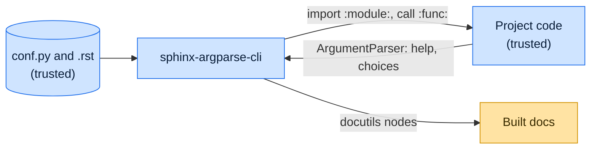

# Threat model

This model says what sphinx-argparse-cli trusts, where untrusted input enters, and which guarantees hold at each
boundary, so a report can be classified as a vulnerability or a bug. [SECURITY.md](SECURITY.md) covers reporting; if the
two disagree, SECURITY.md wins and we fix this file.

## How sphinx-argparse-cli works

The `sphinx_argparse_cli` directive imports the module named by `:module:`, gets the parser either by calling the
function named by `:func:` or, with `:hook:`, by running that function while `ArgumentParser.parse_known_args` is
patched to capture the parser. It walks the parser's actions and subcommands and emits docutils nodes for them, which
Sphinx then renders.

## Compared with similar tools

We drew the boundary where comparable projects in other ecosystems draw theirs. The shared rule, stated by the
[Node.js threat model](https://github.com/nodejs/node/blob/main/SECURITY.md#the-nodejs-threat-model), is that a report
which first needs a trusted element compromised is out of scope; the first triage question, as
[DOMPurify](https://github.com/cure53/DOMPurify/blob/main/SECURITY.md#what-we-consider-a-vulnerability) puts it, is what
the attacker controls.

| Project                                                                              | Language   | Where it draws the line                                                                                             |
| ------------------------------------------------------------------------------------ | ---------- | ------------------------------------------------------------------------------------------------------------------- |
| [Sphinx autodoc](https://www.sphinx-doc.org/en/stable/usage/extensions/autodoc.html) | Python     | Imports the modules it documents and warns that their import-time side effects run; the documented code is trusted. |
| [TypeDoc](https://github.com/TypeStrong/typedoc/security/policy)                     | TypeScript | Documentation generator that loads the project's own compiler setup; patches the latest minor version.              |
| [Hugo](https://gohugo.io/about/security/)                                            | Go         | Templates and configuration are trusted, content is not, and output is escaped by default.                          |

## Trusted

An attacker who controls any of these already has what sphinx-argparse-cli could give them:

- The Sphinx configuration and the documents that use the directive.
- The documented project, its modules and the parser factory, which run during the build.

## Untrusted inputs

| Input             | Comes from                             | What sphinx-argparse-cli guarantees                            |
| ----------------- | -------------------------------------- | -------------------------------------------------------------- |
| Directive options | The `.rst` source of the documentation | Select only which module, function and parser parts to render. |

## Threats and controls

| STRIDE                 | Threat                                               | Control                                                                                                              |
| ---------------------- | ---------------------------------------------------- | -------------------------------------------------------------------------------------------------------------------- |
| Tampering              | A help string with `.. raw:: html` reaches the HTML. | By design: help text is reStructuredText from trusted code; disable `raw` in Sphinx if contributors are not trusted. |
| Elevation of privilege | Building docs runs the project's code.               | Accepted, as in Sphinx autodoc.                                                                                      |

## Release chain

Releases run on the shared [tox-dev/github-workflows](https://github.com/tox-dev/github-workflows) pipeline. A release
App, not a person, pushes the release commit and tag; the build installs its tools hash-checked from `pylock.toml` with
a seven-day upload cooldown; PyPI receives the files through
[trusted publishing](https://docs.pypi.org/trusted-publishers/) with attestations, and the GitHub Release is immutable.
Every workflow pins third-party actions to a commit SHA.

## Vulnerability or bug

| Report                                                 | Verdict             | Why                                    |
| ------------------------------------------------------ | ------------------- | -------------------------------------- |
| A `:module:` of `a.b` imports `c` instead              | Vulnerability       | Import target is a guarantee.          |
| A help string with `.. raw:: html` adds a script       | Not a vulnerability | Help text is trusted reStructuredText. |
| The parser factory deletes files during the docs build | Not a vulnerability | Documented code is trusted.            |
| Subcommand order differs from `--help`                 | Bug                 | Rendering only.                        |

## Accepted risks

- Building documentation executes the documented module's import-time code and parser factory.

## Keeping this current

Revisit this model when sphinx-argparse-cli gains a new input source, network access, a new way to run code, or a new
place it writes to, and whenever an advisory is published.
